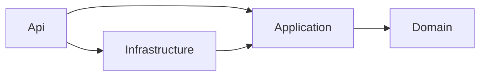

# Turnos Médicos API

API REST para reservar, consultar y cancelar turnos médicos, construida con **ASP.NET Core 10**, **Clean Architecture**, **TDD**, **EF Core** y **SQL Server**.

## Reglas de negocio

- Un turno solo puede reservarse para una fecha y hora **futura**.
- Un turno puede cancelarse solo con **al menos 24 horas de anticipación**.
- Un turno ya cancelado **no puede volver a cancelarse**.

Las reglas viven en la entidad `Turno` del dominio y están cubiertas por tests, incluidos los casos límite (exactamente "ahora" y exactamente 24 horas antes).

## Cómo correrlo

### Con Docker (recomendado)

Requisito: Docker Desktop.

```bash
docker compose up --build
```

Levanta SQL Server y la API, y aplica las migraciones automáticamente. Después:

- **Interfaz para probar la API (Scalar):** http://localhost:8080/scalar
- **Especificación OpenAPI:** http://localhost:8080/openapi/v1.json

### Para desarrollo local

Requisitos: .NET SDK 10 y Docker Desktop.

```bash
docker compose up -d sqlserver     # solo la base de datos
dotnet tool restore                # instala dotnet-ef (herramienta local del repo)
dotnet ef database update --project src/TurnosMedicos.Infrastructure --startup-project src/TurnosMedicos.Api
dotnet run --project src/TurnosMedicos.Api
```

La API queda en http://localhost:5268/scalar. El archivo [`TurnosMedicos.Api.http`](src/TurnosMedicos.Api/TurnosMedicos.Api.http) tiene requests listos para todos los escenarios.

### Tests

```bash
dotnet test
```

## Endpoints

| Método | Ruta | Respuestas |
|---|---|---|
| `POST` | `/turnos` | `201` turno reservado · `400` body inválido · `422` regla de negocio |
| `GET` | `/turnos/{id}` | `200` datos del turno · `404` no existe |
| `POST` | `/turnos/{id}/cancelar` | `204` cancelado · `404` no existe · `422` regla de negocio |

Todos los errores usan el formato estándar **ProblemDetails** ([RFC 9457](https://www.rfc-editor.org/rfc/rfc9457)).

Ejemplo de reserva:

```http
POST /turnos
Content-Type: application/json

{
  "afiliadoId": "3fa85f64-5717-4562-b3fc-2c963f66afa6",
  "profesionalId": "9b2f4c1e-8d3a-4f6b-a1c2-7e5d9f0b3a48",
  "inicio": "2027-03-15T13:00:00Z"
}
```

## Arquitectura



| Proyecto | Responsabilidad | Depende de |
|---|---|---|
| `TurnosMedicos.Domain` | Entidad `Turno`, reglas de negocio, excepciones de dominio | Nada |
| `TurnosMedicos.Application` | Casos de uso (`ReservarTurno`, `ObtenerTurno`, `CancelarTurno`) e interfaces (`ITurnoRepository`) | Domain |
| `TurnosMedicos.Infrastructure` | EF Core, SQL Server, implementación del repositorio, migraciones | Application |
| `TurnosMedicos.Api` | Controllers, manejo de errores, composición de dependencias | Application, Infrastructure |

Cada capa es un proyecto separado, así que la regla de dependencias la hace cumplir el compilador: el dominio no puede referenciar EF Core ni ASP.NET.

```
src/
├── TurnosMedicos.Domain/
├── TurnosMedicos.Application/
├── TurnosMedicos.Infrastructure/
└── TurnosMedicos.Api/
tests/
├── TurnosMedicos.Domain.Tests/        # reglas de la entidad
└── TurnosMedicos.Application.Tests/   # casos de uso con dobles de prueba
```

## Decisiones de diseño

- **El dominio no conoce el reloj.** `Turno.Reservar` y `Turno.Cancelar` reciben el momento actual como parámetro. Los casos de uso lo obtienen de `TimeProvider`, inyectado por DI, y en los tests se reemplaza por `FakeTimeProvider`. Así los tests son determinísticos y no dependen de la fecha en que se corren.
- **Entidad encapsulada.** Propiedades con `private set`, constructor privado y métodos con nombre de negocio (`Reservar`, `Cancelar`). El estado solo cambia a través de reglas.
- **Mapeo de EF Core fuera del dominio.** La configuración vive en `TurnoConfiguration` (Infrastructure), sin atributos de persistencia en la entidad.
- **Fakes en lugar de mocks.** Los tests de Application usan un repositorio en memoria y verifican el *resultado* (qué quedó guardado), no la *interacción* (qué métodos se llamaron). Resisten mejor los refactors.
- **400 vs. 422.** `400` para requests mal formados (validación automática de `[ApiController]`); `422` para requests válidos que violan una regla de negocio. Un único `IExceptionHandler` traduce `DomainException` a `422`, sin `try/catch` en controllers ni casos de uso.
- **CQRS liviano.** Commands y queries separados por intención, sin librerías adicionales. Las queries devuelven DTOs, nunca la entidad.
- **Fechas en UTC** y estados guardados como texto en la base (`"Reservado"`, `"Cancelado"`) para que los datos sean legibles y no dependan del orden del enum.
- **Migraciones al iniciar solo en desarrollo**, activadas por configuración (`Database:AplicarMigracionesAlIniciar`). En producción se aplicarían desde el pipeline de despliegue.

> **Nota:** la contraseña de SQL Server que aparece en `compose.yaml` y `appsettings.Development.json` es solo para el contenedor local. En un entorno real vendría de Azure Key Vault o de variables secretas del pipeline.

## Stack

.NET 10 · ASP.NET Core (controllers) · EF Core 10 · SQL Server 2022 · xUnit · Docker Compose · Scalar (OpenAPI)

## Próximos pasos

- Pipeline de CI en Azure DevOps (build + tests en cada push).
- Tests de integración contra SQL Server real con Testcontainers.
- Regla de no superposición de turnos para un mismo profesional.
- Contratos de request propios de la capa Api, separados de los commands de Application.
